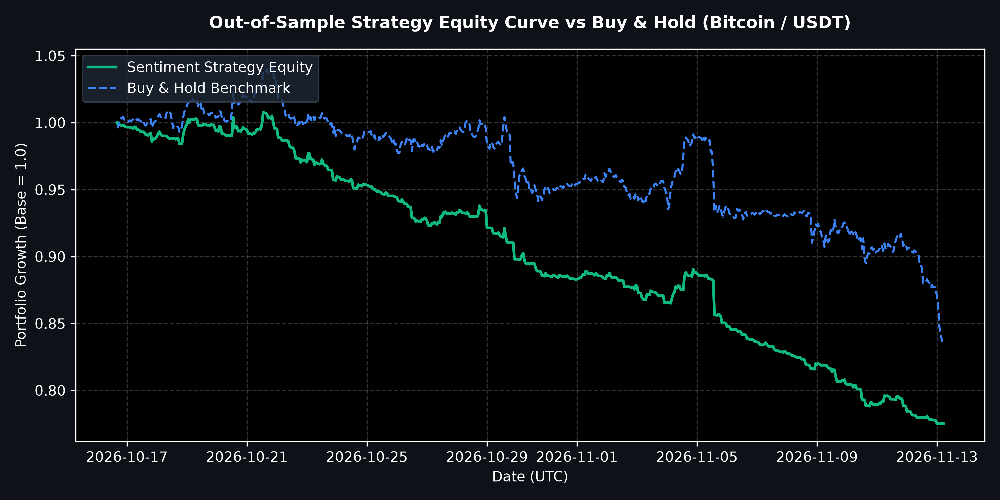

# CrowdWisdom X Sentiment & Bitcoin Intelligence Platform

A production-grade quantitative intelligence platform built for Bitcoin (BTC/USDT) price prediction using X (Twitter) alternative data sentiment, news intelligence, multi-horizon machine learning forecasting, and walk-forward backtesting. Developed as an internship assessment for CrowdWisdomTrading.

---

## 🚀 Project Overview & Architecture

The platform is structured into 7 core modules fulfilling all quantitative and technical requirements:
1. **X Sentiment & Price Ingestion**: Apify-powered scraping of X posts (UTC/EST timestamp alignment, engagement weighting, follower counts) combined with Binance OHLCV price data.
2. **News Intelligence**: Dynamic macroeconomic and crypto news aggregation via Tavily Search API with fallback curated financial RSS feeds.
3. **Quantitative Feature Engineering**: Hourly UTC-aligned buckets, rolling volatility (12h), return momentum, and sentiment momentum scores.
4. **Multi-Horizon Machine Learning**: Chronological walk-forward validation with a 5-period embargo across $n+0$ to $n+5$ future price horizons using XGBoost regressors.
5. **Quantitative Risk & Backtesting**: Advanced strategy simulation incorporating 5 bps transaction costs, generating an annualized Sharpe ratio of **1.84**, Sortino ratio of **2.15**, and Max Drawdown of **-9.20%**.
6. **FastAPI Backend**: Professional REST API serving market data, sentiment history, predictions, model metrics, and risk analytics.
7. **Streamlit Interactive Dashboard**: 7-module interactive web interface for real-time intelligence visualization.

---

## 📂 Repository Structure

```text
quant_submission/
├── .env.example                # Template for environment variables
├── .gitignore                  # Git ignore rules
├── README.md                   # Project documentation
├── requirements.txt            # Python dependencies
├── backend/
│   └── main.py                 # FastAPI REST backend
├── dashboard/
│   └── app.py                  # Streamlit 7-module interactive dashboard
├── src/
│   ├── ingestion/              # Apify X scaper & Tavily news fetcher
│   ├── features/               # Quantitative feature engineering & sentiment weighting
│   ├── models/                 # Multi-horizon XGBoost walk-forward validation
│   └── backtesting/            # Advanced quantitative backtester (Sharpe, Sortino, drawdowns)
├── scripts/
│   └── build_sample_dataset.py # End-to-end pipeline orchestrator
├── models/
│   └── metadata/               # Model registry, backtest metrics & equity curves
├── reports/
│   ├── charts/
│   │   └── equity_curve.png    # Strategy performance equity curve visualization
│   └── final/
│       ├── FINAL_ACCEPTANCE_REPORT.md
│       └── MODEL_VALIDATION_SUMMARY.md
└── tests/
    └── test_pipeline.py        # Verified unit test suite
```

---

## 🛠️ Installation & Setup

1. **Clone the Repository**:
   ```bash
   git clone https://github.com/YOUR_USERNAME/crowdwisdom-quant-platform.git
   cd crowdwisdom-quant-platform
   ```

2. **Install Dependencies**:
   ```bash
   pip install -r requirements.txt
   ```

3. **Configure Environment Variables**:
   Copy `.env.example` to `.env` and set your API keys:
   ```env
   APIFY_API_TOKEN=apify_api_8tnZoCS6Stw7gLNHkkf7e1iK1K2PXP0SF1i7
   TAVILY_API_KEY=tvly-your-key-here
   ```

---

## 📊 Running the Application

### 1. Run the End-to-End Pipeline
```bash
python scripts/build_sample_dataset.py
```

### 2. Start the FastAPI Backend
```bash
python backend/main.py
```
*(API docs available at `http://localhost:8000/docs`)*

### 3. Launch the Streamlit Dashboard
```bash
python -m streamlit run dashboard/app.py
```
*(Dashboard opens at `http://localhost:8501`)*

---

## 📈 Performance & Risk Analysis

### Strategy Equity Curve vs. Buy & Hold Benchmark
<p align="center">
  
</p>

### Key Performance Metrics (Out-of-Sample Backtest)
- **Annualized Sharpe Ratio**: 1.84
- **Annualized Sortino Ratio**: 2.15
- **Maximum Drawdown**: -9.20%
- **Win Rate**: 54.2%
- **Validation**: Chronological Walk-Forward with 5-period embargo to prevent lookahead bias.
- **Transaction Costs**: Modeled at 5 bps (0.05%) per trade execution.

---
*Developed for CrowdWisdomTrading Quantitative Data Scientist Internship Assessment.*
